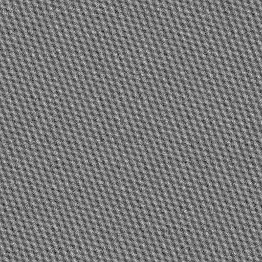
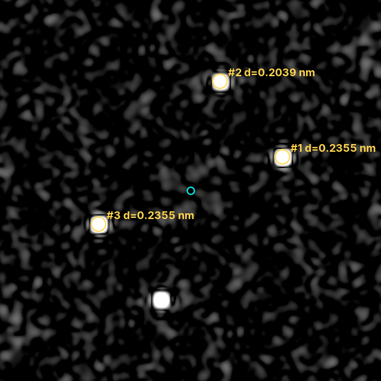
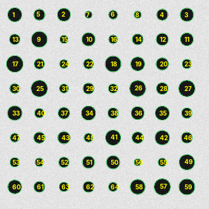
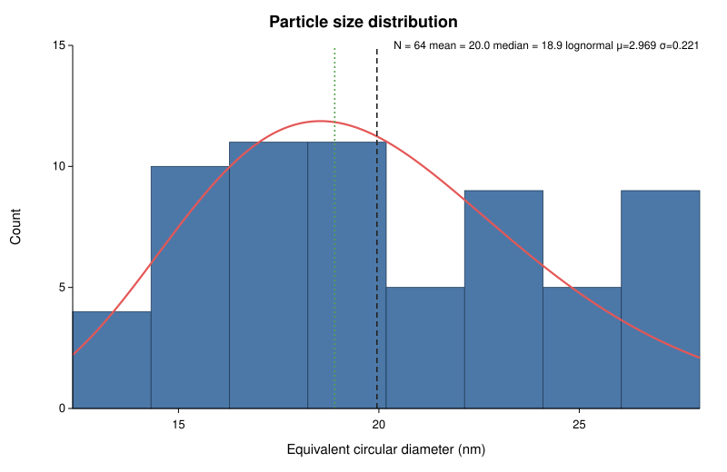
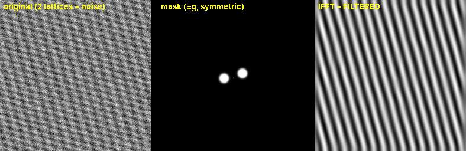

# Worked examples (generated by `ExamplesGenerator`)

All inputs are synthetic images with exactly known content, so every number below can be checked against ground truth.

## 1. Interactive FFT – interplanar distances

 

Synthetic Au-like HRTEM image, pixel 0.0189 nm, ROI 256×256 px, Hann window, zero-padded to 1024.

| Reflection | True d (nm) | Measured d (nm) | Error |
|---|---|---|---|
| #1 | 0.2355 | 0.23555 | +0.021 % |
| #2 | 0.2039 | 0.20390 | +0.002 % |
| #3 | 0.2355 | 0.23555 | +0.021 % |

Symmetric pair #1/#3: d = 0.23555 nm (Δd between the two = 0.000 %, origin offset 0.000 px).  
Angle #1–#2: 54.75° (true 54.74°).

## 2. Particle segmentation and histogram

64 disks with diameters drawn uniformly in 12–28 nm (pixel 1 nm), Otsu + watershed.

| | Ground truth | Measured |
|---|---|---|
| N | 64 | 64 |
| Mean ECD (nm) | 19.935 | 19.952 |
| SD (nm) | 4.353 | 4.389 |
| Median (nm) | 18.979 | 18.898 |

Table: [04_particles.csv](04_particles.csv)

## 3. Fourier filtering and IFFT

Mask around the 0.32 nm reflection (plus its automatic Friedel mate). Imaginary residual of the inverse transform: 8.6e-18 (Hermitian symmetry preserved). d measured on the reconstruction: 0.3199 nm (true 0.32 nm). Mask: `Fourier-filtered (IFFT) region x=0, y=0, 256×256 px. Mask: 1 shape(s): Circle(dx=15.454813220625093, dy=-4.141104721640332, radius=6.0, softness=2.0) | symmetric=true invert=false keepDC=true`.
